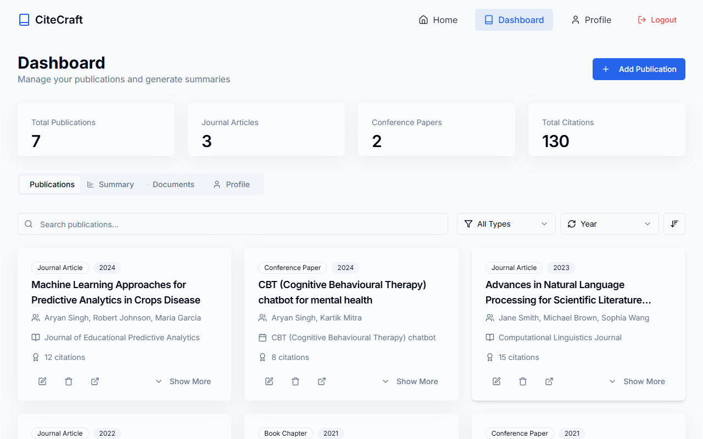

The original CiteCraft: a front-end demo for faculty members to manage and showcase publications.

## Included

- Landing page, demo sign-in and dashboard
- Add, edit and delete publications (kept in the page, not saved)
- Publication summary with charts: overview, timeline, venues and collaborators
- Profile page

This version has no back end. It has been replaced by [v2.0.0](https://github.com/AryanSinghh07/CiteCraft/releases/tag/v2.0.0).
