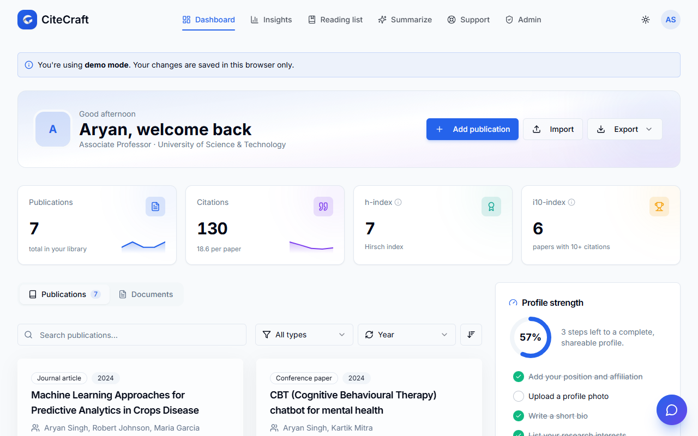

CiteCraft v2 turns the original front-end demo into a complete academic workspace for researchers and students.

## Highlights

- **Real accounts** — sign up, sign in, password reset and two-factor authentication, backed by Supabase (Postgres with row-level security). Without a back end the app runs in demo mode in the browser.
- **Publications** — DOI lookup, bulk import from DOIs or BibTeX, and export to CSV, BibTeX, APA / MLA / IEEE or a printable CV.
- **Research insights** — h-index, i10-index, citations over time, top venues, collaborators and topics.
- **Public profile** — a shareable page at `/u/your-name`.
- **Documents** — a private library with an in-app viewer for every file type: PDF (all pages, zoom), Word, PowerPoint, Excel / CSV, images, Markdown, code, notebooks, audio and video.
- **Summaries** — summarize any document with AI (when the server function is deployed) or with the free quick summary that runs in the browser, with automatic fallback.
- **Students** — student accounts and work types, a College section (timetable, assignments & exams, attendance with the 75% rule, SGPA / CGPA, focus timer), reading list and a free citation generator.
- **Support** — ticket system with replies, attachments, internal notes, ratings and an admin panel, plus an in-app guide.
- **Security** — security level, two-factor authentication enforced in the database, password strength checks, sign out other devices, data download, account deletion, and strict security headers.
- **Design** — new landing page and navigation, light / dark / system theme, animations, mobile layout and a new logo.

## Upgrading a Supabase project

Run every file in `supabase/migrations` in order (`0001` → `0009`) in the Supabase SQL editor. All of them are safe to run again. See [docs/SETUP.md](https://github.com/AryanSinghh07/CiteCraft/blob/v2.0.0/docs/SETUP.md).

## Downloads

- `citecraft-v2.0.0-web.zip` — the built website (demo mode). Upload it to any static host with a single-page-app fallback to `index.html`.
